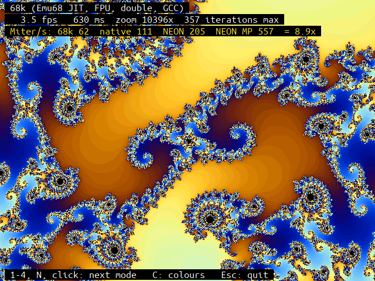

# NativeCall

Let 68k programs on an Amiga with a **PiStorm + Raspberry Pi 4 (Emu68)** call native **AArch64** functions.
The idea is the one behind WarpOS/PowerUP on PowerPC cards: everything that talks to AmigaOS stays on the 68k,
and the heavy computing runs natively, with NEON and on several ARM cores.

**The Emu68 kernel is not modified.** NativeCall is one file on the SD card, one line in `config.txt`, and a
shared library. Programs keep working on any Amiga: without NativeCall the same code runs as 68k.

For a guided explanation, see **[docs/NativeCall.pdf](docs/NativeCall.pdf)**.



| Workload (A1200, Pi 4) | 68k (Emu68 JIT) | Native | Gain |
|---|---:|---:|---:|
| CRC32, 4 MB (hardware instruction) | 52.11 ms | 2.38 ms | 21.9x |
| 4x4 matrix × 10 000 vertices (NEON) | 1.01 ms | 0.11 ms | 9.2x |
| Mandelbrot zoom (NEON, 3 cores) | 3.2 fps | 27.1 fps | 8.8x in iterations/s |
| Software 3D torus (1 core) | 44.6 fps | 169.3 fps | 3.8x |
| GPU-limited demo (Boing Ocean) | 55.3 fps | 55.8 fps | +0.9% |

Full measurements: [RESULTS.md](RESULTS.md).

## Status

Version **1.6.0**: `nativecall.library` 1.5, hypervisor 5.

- **Hardware: Raspberry Pi 4.** Hypervisor 5 finds its place in the device tree (the top 2 MB of RAM, taken
  from Emu68's view), so it no longer depends on the 8 GB model. If the layout is not the expected one, the
  armstub starts Emu68 like the stock one, without native calls; it does not leave a black screen.
  See [INSTALL.md](INSTALL.md).
- Tested on one machine: A1200, PiStorm32-lite, Pi 4 8 GB, Emu68 `1.1.0-beta.1 git:0ba3a89`, AmigaOS 3.2. The 1,
  2 and 4 GB layouts are tested in QEMU only (NOTES.md 25).

## How it works

```
 68k program (VBCC or GCC)                         Raspberry Pi 4
 ┌──────────────────────┐
 │ nc_call / nc_run /   │
 │ nc_run_mp / nc_start │     Core 0: Emu68 JIT at EL1
 └──────────┬───────────┘     ┌──────────────────────────────────────┐
            │                 │ CPUSHL DC,(A0)  ->  dc civac         │
 ┌──────────▼───────────┐     └──────────────────┬───────────────────┘
 │ nativecall.library   │                        │ HCR_EL2.TPC trap
 │ 64-byte call block,  │     ┌──────────────────▼───────────────────┐
 │ D0/D1 doorbell,      │     │ Hypervisor at EL2 (the armstub)      │
 │ CPUSHL DC,(A0)       │     │ checks the request, runs the kernel  │
 └──────────────────────┘     └──────┬──────────────────┬────────────┘
                                     │                  │ jobs
                          native kernel (EL2)   Cores 1, 3: idle "wfe"
                          on core 0             of Emu68 traps here too
```

1. **The armstub.** `armstub=nativecall-armstub.bin` in `config.txt` makes the Pi firmware start our code
   instead of its default stub. It takes the top 2 MB of RAM out of the device tree, so Emu68 never sees them,
   copies a small hypervisor there, and enters
   Emu68 at EL1 with `HCR_EL2.TPC` set, which traps `DC CIVAC` to EL2.
2. **A request.** The 68k fills a 64-byte call block in Fast RAM, loads a "doorbell" value into D0/D1 and runs
   `CPUSHL DC,(A0)` in supervisor mode. Emu68's JIT turns that into `dc civac`, which traps to the hypervisor.
   Without the hypervisor it is a harmless cache flush: the status stays 0, and the program uses its 68k code.
3. **Why a doorbell.** All other `dc civac` operations (DMA buffers, Emu68's own flushes) are redone on the
   physical address and otherwise ignored. Only with the D0/D1 values does the hypervisor look at memory, so data
   that happens to contain the magic word can never be taken for a request.
4. **Native code.** The kernel runs at EL2 with Emu68's FP/SIMD state saved. Its own memory map leaves out the
   low 16 MB (chip RAM, hardware), so a bad pointer ends in `NC_ST_FAULT`, not a crash. Emu68 runs AArch64
   big-endian, so kernels are built `-mbig-endian` and 68k data needs no conversion.
5. **Keeping the 68k alive.** During a call on core 0, 68k interrupts wait. `nc_run` cuts big jobs into pieces of
   about 0.5 ms and learns the right size per kernel, so sound and input keep running between pieces.
6. **More cores.** Emu68 leaves cores 1 and 3 idle in a `wfe` loop. Before they enter Emu68, the hypervisor sets
   `MDCR_EL2.TPM`; Emu68's first PMU access traps, and it then turns on `HCR_EL2.TWE`. From there each idle `wfe`
   lands in the hypervisor, which hands out pieces of work. Core 2 (the PiStorm housekeeper) is left alone.
7. **Asynchronous jobs.** `nc_start_mp` gives a job to the helper cores and returns: the 68k and its interrupts
   keep running. `nc_wait` collects the result.

Details and the Emu68 source references: [NOTES.md](NOTES.md).

## Writing a program

Write a kernel once; the SDK builds it for the Pi and as the 68k fallback.

```c
/* myprog_kernels.c */
NC_KERNEL(scale)
{
    struct ScaleParams *p = params;
    NC_S16 *s = NC_PTR(NC_S16, p->samples);

    for (NC_U32 i = p->range.from; i < p->range.to; i++)
        s[i] = (NC_S16)((s[i] * p->factor) >> 8);
    return 0;
}

/* main.c: an ordinary AmigaOS program */
struct NCKernels *k = nc_open(&myprog_kernels);
nc_run_mp(k, NCK_scale, p, sizeof(*p), 0, count);
```

```sh
sdk/nc image                # once: Docker image nativecall-sdk:1
sdk/nc new myprog
cd myprog
../sdk/nc make              # VBCC
../sdk/nc make CC68=gcc     # GCC
```

Kernel rules, the API, batching, memory, and adding it to an existing project: [sdk/README.md](sdk/README.md).

## Installing

Copy `nativecall-armstub.bin` to the SD card's FAT partition, add `armstub=nativecall-armstub.bin` to
`config.txt`, copy `nativecall.library` to `LIBS:`, and power the Amiga off and on. To go back, comment out the
line. Details: [INSTALL.md](INSTALL.md). Ready-made binaries and the SDK are in the
[releases](https://github.com/Sdursun/NativeCall/releases).

## Building from source

Needs Docker. On Windows use Git Bash.

```sh
sdk/nc image        # the nativecall-sdk:1 image
./build.sh          # armstub, library, examples with VBCC and GCC -> dist/
```

On Windows, clone with `core.autocrlf=false`; CRLF line endings break the Linux builds.

## Tests

### QEMU: the hypervisor without hardware

`qemu/run.sh hv` boots **unmodified Emu68** under the hypervisor on QEMU's `raspi3b` or `raspi4b` and runs a bare
68k test program. `python3 qemu/test_all.py` runs every scenario below and checks the results. Setup:
[qemu/README.md](qemu/README.md). Every hypervisor change goes through this before hardware.

| Scenario | Machine | Expected |
|---|---|---|
| `base` | raspi3b, raspi4b | Emu68 alone: every request comes back with status 0 |
| `hv` | raspi3b, raspi4b | hypervisor placed from the device tree; all tests below pass, top of RAM 2 MB lower |
| `refuse` | raspi3b, raspi4b | a placement the parser must refuse: status 0, top of RAM unchanged |
| `stub` | raspi4b | the **real armstub**, all cores starting at 0 in EL3 as with the firmware; all tests pass |
| `stubrefuse` | raspi4b | the real armstub, initrd at the top of RAM: refused, Emu68 boots without it |
| `fdt` | PC | the device tree parser alone: 16 layouts (1, 2, 4, 8 GB, `total_mem`, bad trees) |

`raspi4b` is QEMU 9.2 with three small patches (`tools/qemu/qemu9-patch.py`): `wfe` traps, RAM as one node with
two blocks and 32-bit initrd values, as the Pi firmware writes them. Stock Emu68 then reports the same RAM limits
as on the A1200.

Tests of the 68k program:

| Test | Checks | Expected |
|---|---|---|
| `SPOOF` | a block that looks like a request, flushed without the doorbell | left alone: magic intact, status 0 |
| `PING` | the hypervisor answers | `'NARM'`, status 1 |
| `SYNC` | ARM I-cache sync of a module | status 1 |
| `ADD` | native call `add(40, 2)` and its run time | 42, ticks and frequency |
| `FAULT` | a kernel reading unmapped memory | status `0x84`, ESR and FAR, machine goes on |
| `BADENTRY` | a function that is not a module entry | status `0x82` |
| `LOOP1000` | 1000 calls | 0 errors |
| `HELPERS` | core capture | cores 1 and 3 (`0x0a`) |
| `RUNMP` | job shared between cores | 4096 units, cores 0, 1, 3, none missing |
| `RUNMPFLT` | a fault during a shared job | status `0x84` |
| `RUNMP200` | 200 shared jobs | 0 errors |
| `ASTART` / `AWAIT` | asynchronous job | 68k loops during it; only cores 1 and 3 work; result right |
| `ABUSY` | a fifth job with all slots taken | status `0x85` |
| `AWAIT4` / `AFAULT` / `ABADJOB` | waiting for four jobs; a fault; an unknown job | right result; `0x84`; `0x86` |

`qemu/run.sh base` runs the same program without the hypervisor: every request must come back with status 0.

QEMU's vCPUs take turns here rather than running in parallel, so this verifies the protocol, not the speed. It
does not cover the real Pi 4 firmware, the GIC, or caches.

### Real hardware: the example programs

| Command | Checks |
|---|---|
| `hello` | `42 (native)` |
| `hello LOOP=1000 FAULT` | 1000 calls without errors; the crash is caught (`status 0x84`) |
| `hello MP` | units per ARM core, `nc_run` against `nc_run_mp`, none missing |
| `hello ASYNC` | the job runs on cores 1 and 3 while the 68k keeps running |
| `hello HEAP` | the allocator gives the same result on the 68k and natively |
| `hello TIME` | the cost of a call, the clock, and a job |
| `cputest` | primes and Mandelbrot: 68k, native, NEON, results compared |
| `bench` | Adler32, CRC32, matrices; results checked against the 68k |
| `ncdemo` | software 3D, `N` switches 68k ↔ native |
| `mandeldemo` | Mandelbrot zoom, keys `1`-`4`: 68k, native, NEON, NEON on all cores |

Also tested during development:

- **Build ID:** no `.narm`, right `.narm`, wrong `.narm` (`NC_ST_MISMATCH`, falls back to the 68k), and an `ENV:`
  override.
- **Soak:** 5 million native calls in the background during 5 × 16 MB of network copies; the md5 sums matched and
  Workbench kept responding.
- **WinUAE (68060, no armstub):** with and without the library, both compilers fall back to the 68k with right
  results.

**Exactly what ran on this release's binaries.** `./build.sh` reproduces the armstub and library byte for byte.
With them on the A1200 (hypervisor 5), `hello LOOP=1000 FAULT MP ASYNC` (GCC and VBCC) and `bench` (GCC) passed,
and all QEMU scenarios above passed on the source of this commit. `mandeldemo` from this build last ran with
hypervisor 4, `cputest` with hypervisor 3. `ncdemo` was last run on hardware before modules gained `--gc-sections`.

**Not tested:** `async_log` / `ppc_enable` with several cores, a real Pi 4 with 1, 2 or 4 GB, and a machine other
than the one above.

## Limitations

- During a call on core 0, 68k interrupts wait: keep calls near 1 ms or use `nc_run`.
- An endless loop in a kernel locks the machine. There is no stack guard (64 KB per core).
- Native code sees only Fast RAM above 16 MB, and makes no AmigaOS calls.
- A plain C kernel gains about 2x, since Emu68's JIT is already good. The big gains need NEON, special instructions,
  several cores, or a batch instead of many small calls. GPU-limited programs gain little.
- Three cores at full load heat a Pi 4 past 80 °C without cooling, and it slows down.

## Repository layout

```
hypervisor/     armstub and EL2 hypervisor
sdk/            SDK: library, headers, kernels support, tools, examples, template
qemu/           hypervisor test with unmodified Emu68
tools/qemu/     Docker images for that test
docs/           NativeCall.pdf and its HTML source
INSTALL.md      installation and rollback
RESULTS.md      measurements
NOTES.md        technical notes, with Emu68 source references
```

Emu68 itself is not part of this repository: https://github.com/michalsc/Emu68

## Credits and licenses

- `hypervisor/boot.S` is based on `armstub8.S` from https://github.com/raspberrypi/tools (BSD 3-Clause, notice in
  the file).
- Built with VBCC, vasm, vlink, GCC, and the Hyperion NDK 3.2; none of their sources are in this repository.
- `tools/qemu/wfe-trap.py` patches QEMU's source when the test image is built; QEMU itself is not included.

No license has been chosen yet for the rest of this project: all rights reserved by the author.
