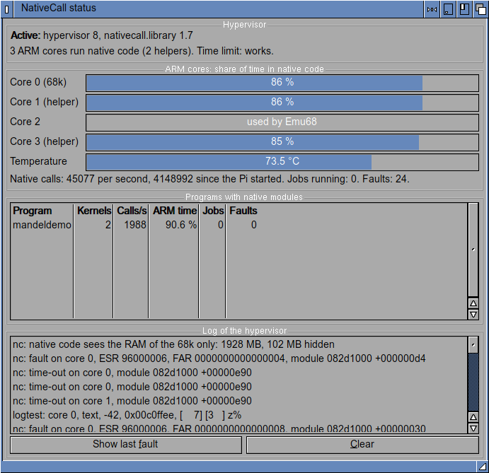

# NativeCall

Let 68k programs on an Amiga with a **PiStorm + Raspberry Pi 4 (Emu68)** call native **AArch64** functions.
The idea is the one behind WarpOS/PowerUP on PowerPC cards: everything that talks to AmigaOS stays on the 68k,
and the heavy computing runs natively, with NEON and on several ARM cores.

**The Emu68 kernel is not modified.** NativeCall is one file on the SD card, one line in `config.txt`, and a
shared library. Programs keep working on any Amiga: without NativeCall the same code runs as 68k.

**Under WinUAE the same programs run their kernels on the PC's x64 processor** (since 1.8.0): one SDK, one
kernel source, one 68k binary for the Pi, for WinUAE and for any other Amiga. See
[sdk/x64/README.md](sdk/x64/README.md).

For a guided explanation, see **[docs/NativeCall.pdf](docs/NativeCall.pdf)**.


| Workload (A1200, Pi 4) | 68k (Emu68 JIT) | Native | Gain |
|---|---:|---:|---:|
| CRC32, 4 MB (hardware instruction) | 52.11 ms | 2.38 ms | 21.9x |
| 4x4 matrix × 10 000 vertices (NEON) | 1.01 ms | 0.11 ms | 9.2x |
| Ray tracing (`raydemo`, 3 cores) | 1.9 fps | 33.6 fps | 18.4x |
| Rotate, scale and 3x3 filter (`filterdemo`, 3 cores) | 9.7 fps | 125.3 fps | 15.5x |
| 1500-body gravity (`nbodydemo`, 3 cores) | 6.0 fps | 61.0 fps | 10.9x |
| Mandelbrot zoom (NEON, 3 cores) | 3.2 fps | 27.1 fps | 8.8x in iterations/s |
| MP3 decoding (`mp3demo`, 1 core) | 27.8x real time | 198x real time | 7.1x |
| Voxel landscape (`voxeldemo`, 3 cores) | 40.7 fps | 198.3 fps | 6.0x |
| Software 3D torus (`ncdemo`, 3 cores) | 50.4 fps | 204.6 fps | 4.1x |
| GPU-limited demo (Boing Ocean) | 55.3 fps | 55.8 fps | +0.9% |

The gains of the graphics demos compare the time to compute a frame, without the copy to the screen. Full
measurements: [RESULTS.md](RESULTS.md).

## Status

Version **1.8.0**: `nativecall.library` 1.8, hypervisor 8 (the armstub has not changed since 1.7.0). New since
1.7.0:

- **WinUAE x64 backend:** without the hypervisor, the library runs kernels on the PC through WinUAE's
  `uaenative.library` and a host DLL in WinUAE's `plugins` folder. Programs do not change; programs built with
  this SDK (`NC_X64 := 1`) carry the x64 module inside, and v1.7.0 binaries use a `.nx64` file next to them.
  `nc_run_mp` and `nc_start_mp` run on a thread pool (all logical processors but one), and faults, the time
  limit, the log, fault details and statistics work as on the Pi. `mandeldemo`, the v1.7.0 binary: 58.5 Miter/s
  on WinUAE's 68k JIT, 6044 Miter/s on a 24-thread PC (103x).
- **Byte order:** the Pi and the 68k are big-endian, the PC is not. Parameter structures are converted by the
  compiler; plain arrays in 68k memory are read and written with `NC_GET16/32/F` and `NC_PUT16/32/F`, which are
  plain accesses on the Pi (all `.narm` modules of the examples are byte for byte those of 1.7.0).
- **SDK:** `nc_now_us` reads the PC's clock under WinUAE (the emulation's clock misses the time a kernel runs);
  `nc_addr_ok` accepts all of the Amiga's RAM there.
- **Fixes:** `mp3demo BENCH` said "No MP3 sound found" for files shorter than `SECONDS` (20 by default); x64
  modules now use the SDK's runtime and `nc_heap` as on the Pi (8 to 12 KB instead of 40 to 60).

Tested on the A1200 with library 1.8 (all examples, GCC and VBCC, and the v1.7.0 binaries) and under WinUAE
6.1 beta (below).

New in 1.7.0:

- **Time limit:** a kernel that runs too long (1 s by default, `nc_set_timeout`) is stopped and the call returns
  `NC_ST_TIMEOUT`. An endless loop no longer locks the machine.
- **Memory protection:** native code sees only the RAM the 68k sees. The hypervisor's code and page tables are
  read-only, Emu68's private memory is hidden, and every stack has a guard page.
- **Log and fault details:** `nc_printf` in kernels, the `NCLog` tool, registers and a backtrace of the last fault,
  `nc addr2line` to turn it into source lines.
- **Job cancel:** `nc_cancel`; jobs of a program that exits or crashes are cancelled instead of writing to freed
  memory.
- **Status:** `NCStatus` (a MUI window) and `NCLog STATS` show whether NativeCall is active, how much of each ARM
  core's time goes to native code, the temperature, and which programs have native modules loaded.
- **Five new demos** (ray tracing, voxel landscape, n-body, image filter, MP3 player), and `ncdemo` on all cores.
- **A fix you need:** modules built with the 1.5.0 or 1.6.0 SDK did not contain their `.bss`. A kernel with
  zero-initialised static or global variables wrote past its module and could corrupt memory. **Rebuild such
  modules with this SDK** (NOTES.md 26.7). Library 1.6 and newer also keep 64 KB of slack behind a module, which
  protects old modules whose `.bss` is smaller than that.
- **Faster 68k fallback:** new default compiler flags for the 68k side; `ncdemo`'s 68k path went from 24.8 to
  49 fps with the same compiler (NOTES.md 27).




- **Hardware: Raspberry Pi 4.** Hypervisor 5 finds its place in the device tree (the top 2 MB of RAM, taken
  from Emu68's view), so it no longer depends on the 8 GB model. If the layout is not the expected one, the
  armstub starts Emu68 like the stock one, without native calls; it does not leave a black screen.
  See [INSTALL.md](INSTALL.md).
- Tested on one machine: A1200, PiStorm32-lite, Pi 4 8 GB, Emu68 `1.1.0-beta.1 git:0ba3a89`, AmigaOS 3.2. The 1,
  2 and 4 GB layouts are tested in QEMU only (NOTES.md 25).
- Library and hypervisor versions work with each other in any combination; missing features fall back.

## How it works

```
 68k program (VBCC or GCC)                         Raspberry Pi 4
 ┌──────────────────────┐
 │ nc_call / nc_run /   │
 │ nc_run_mp / nc_start │     Core 0: Emu68 JIT at EL1
 └──────────┬───────────┘     ┌──────────────────────────────────────┐
            │                 │ CPUSHL DC,(A0)  ->  dc civac         │
 ┌──────────▼───────────┐     └──────────────────┬───────────────────┘
 │ nativecall.library   │                        │ HCR_EL2.TPC trap
 │ 64-byte call block,  │     ┌──────────────────▼───────────────────┐
 │ D0/D1 doorbell,      │     │ Hypervisor at EL2 (the armstub)      │
 │ CPUSHL DC,(A0)       │     │ checks the request, runs the kernel  │
 └──────────────────────┘     └──────┬──────────────────┬────────────┘
                                     │                  │ jobs
                          native kernel (EL2)   Cores 1, 3: idle "wfe"
                          on core 0             of Emu68 traps here too
```

1. **The armstub.** `armstub=nativecall-armstub.bin` in `config.txt` makes the Pi firmware start our code
   instead of its default stub. It takes the top 2 MB of RAM out of the device tree, so Emu68 never sees them,
   copies a small hypervisor there, and enters
   Emu68 at EL1 with `HCR_EL2.TPC` set, which traps `DC CIVAC` to EL2.
2. **A request.** The 68k fills a 64-byte call block in Fast RAM, loads a "doorbell" value into D0/D1 and runs
   `CPUSHL DC,(A0)` in supervisor mode. Emu68's JIT turns that into `dc civac`, which traps to the hypervisor.
   Without the hypervisor it is a harmless cache flush: the status stays 0, and the program uses its 68k code.
3. **Why a doorbell.** All other `dc civac` operations (DMA buffers, Emu68's own flushes) are redone on the
   physical address and otherwise ignored. Only with the D0/D1 values does the hypervisor look at memory, so data
   that happens to contain the magic word can never be taken for a request.
4. **Native code.** The kernel runs at EL2 with Emu68's FP/SIMD state saved. Its own memory map holds only the RAM
   the 68k sees above 16 MB: no chip RAM or hardware, none of Emu68's private memory, the hypervisor's code
   read-only. A bad pointer or a stack overflow ends in `NC_ST_FAULT`, not a crash. Emu68 runs AArch64
   big-endian, so kernels are built `-mbig-endian` and 68k data needs no conversion.
5. **Keeping the 68k alive.** During a call on core 0, 68k interrupts wait. `nc_run` cuts big jobs into pieces of
   about 0.5 ms and learns the right size per kernel, so sound and input keep running between pieces.
6. **More cores.** Emu68 leaves cores 1 and 3 idle in a `wfe` loop. Before they enter Emu68, the hypervisor sets
   `MDCR_EL2.TPM`; Emu68's first PMU access traps, and it then turns on `HCR_EL2.TWE`. From there each idle `wfe`
   lands in the hypervisor, which hands out pieces of work. Core 2 (the PiStorm housekeeper) is left alone.
7. **Asynchronous jobs.** `nc_start_mp` gives a job to the helper cores and returns: the 68k and its interrupts
   keep running. `nc_wait` collects the result, `nc_cancel` stops the job.
8. **Time limit.** Before native code starts, the hypervisor arms the EL2 timer (`CNTHP`). The armstub routes that
   interrupt as a Group 0 FIQ in the GIC, which Emu68 does not use and, running non-secure, cannot change. When
   it fires, the call ends like a fault, with `NC_ST_TIMEOUT`.
9. **Log and statistics.** The hypervisor keeps a 16 KB ring of text (kernels' `nc_printf`, a line per fault and
   time-out), the registers and backtrace of the last fault, and per core the time spent in native code.

Details and the Emu68 source references: [NOTES.md](NOTES.md).

**Under WinUAE** (no Pi, no hypervisor) the library finds WinUAE's `uaenative.library` instead and loads
`nativecall-windows-x86-64.dll` from WinUAE's `plugins` folder. Each module's kernels are also built as a small
Windows DLL (the `.nx64`, embedded in the program); the host DLL loads it and calls the kernels with WinUAE's
host address of Amiga memory. Kernels see the 68k's data in its big-endian layout: the compiler converts
parameter structures (`scalar_storage_order`), and `NC_GET32` & co. convert plain arrays. A vectored exception
handler and a watchdog thread turn crashes and endless loops into `NC_ST_FAULT` and `NC_ST_TIMEOUT`, so WinUAE
goes on. Details: [sdk/x64/README.md](sdk/x64/README.md), [NOTES.md](NOTES.md) 30.

## Writing a program

Write a kernel once; the SDK builds it for the Pi and as the 68k fallback.

```c
/* myprog_kernels.c */
NC_KERNEL(scale)
{
    struct ScaleParams *p = params;
    NC_S16 *s = NC_PTR(NC_S16, p->samples);

    for (NC_U32 i = p->range.from; i < p->range.to; i++)
        s[i] = (NC_S16)((s[i] * p->factor) >> 8);
    return 0;
}

/* main.c: an ordinary AmigaOS program */
struct NCKernels *k = nc_open(&myprog_kernels);
nc_run_mp(k, NCK_scale, p, sizeof(*p), 0, count);
```

```sh
sdk/nc image                # once: Docker image nativecall-sdk:1
sdk/nc new myprog
cd myprog
../sdk/nc make              # VBCC
../sdk/nc make CC68=gcc     # GCC
```

Kernel rules, the API, batching, memory, and adding it to an existing project: [sdk/README.md](sdk/README.md).
`NC_X64 := 1` in the Makefile also builds the kernels for WinUAE; kernels that compute with 16-bit, 32-bit or
float values in plain 68k arrays read and write them with `NC_GET32` / `NC_PUT32` & co.

## Installing

Copy `nativecall-armstub.bin` to the SD card's FAT partition, add `armstub=nativecall-armstub.bin` to
`config.txt`, copy `nativecall.library` to `LIBS:`, and power the Amiga off and on. To go back, comment out the
line. Details: [INSTALL.md](INSTALL.md). Ready-made binaries and the SDK are in the
[releases](https://github.com/Sdursun/NativeCall/releases).

WinUAE: copy `nativecall-windows-x86-64.dll` to WinUAE's `plugins` folder, turn on Settings > Host >
Miscellaneous > Allow native code (`native_code=true`), and copy `nativecall.library` to `LIBS:`.

## Building from source

Needs Docker. On Windows use Git Bash.

```sh
sdk/nc image        # the nativecall-sdk:1 image
./build.sh          # armstub, library, examples with VBCC and GCC -> dist/
```

On Windows, clone with `core.autocrlf=false`; CRLF line endings break the Linux builds.

## Tests

### QEMU: the hypervisor without hardware

`qemu/run.sh hv` boots **unmodified Emu68** under the hypervisor on QEMU's `raspi3b` or `raspi4b` and runs a bare
68k test program. `python3 qemu/test_all.py` runs every scenario below and checks the results. Setup:
[qemu/README.md](qemu/README.md). Every hypervisor change goes through this before hardware.

| Scenario | Machine | Expected |
|---|---|---|
| `base` | raspi3b, raspi4b | Emu68 alone: every request comes back with status 0 |
| `hv` | raspi3b, raspi4b | hypervisor placed from the device tree; all tests below pass, top of RAM 2 MB lower |
| `refuse` | raspi3b, raspi4b | a placement the parser must refuse: status 0, top of RAM unchanged |
| `stub` | raspi4b | the **real armstub**, all cores starting at 0 in EL3 as with the firmware; all tests pass |
| `stubrefuse` | raspi4b | the real armstub, initrd at the top of RAM: refused, Emu68 boots without it |
| `fdt` | PC | the device tree parser alone: 16 layouts (1, 2, 4, 8 GB, `total_mem`, bad trees) |

`raspi4b` is QEMU 9.2 with four small patches (`tools/qemu/qemu9-patch.py`): `wfe` traps, RAM as one node with
two blocks, 32-bit initrd values as the Pi firmware writes them, and a GIC with Security Extensions as the
BCM2711's GIC-400 has (the time limit needs them). Stock Emu68 then reports the same RAM limits
as on the A1200.

Tests of the 68k program:

| Test | Checks | Expected |
|---|---|---|
| `SPOOF` | a block that looks like a request, flushed without the doorbell | left alone: magic intact, status 0 |
| `PING` | the hypervisor answers | `'NARM'`, status 1 |
| `SYNC` | ARM I-cache sync of a module | status 1 |
| `ADD` | native call `add(40, 2)` and its run time | 42, ticks and frequency |
| `FAULT` | a kernel reading unmapped memory | status `0x84`, ESR and FAR, machine goes on |
| `BADENTRY` | a function that is not a module entry | status `0x82` |
| `LOOP1000` | 1000 calls | 0 errors |
| `HELPERS` | core capture | cores 1 and 3 (`0x0a`) |
| `RUNMP` | job shared between cores | 4096 units, cores 0, 1, 3, none missing |
| `RUNMPFLT` | a fault during a shared job | status `0x84` |
| `RUNMP200` | 200 shared jobs | 0 errors |
| `ASTART` / `AWAIT` | asynchronous job | 68k loops during it; only cores 1 and 3 work; result right |
| `ABUSY` | a fifth job with all slots taken | status `0x85` |
| `AWAIT4` / `AFAULT` / `ABADJOB` | waiting for four jobs; a fault; an unknown job | right result; `0x84`; `0x86` |
| `TIMEOUT` / `TMORUNMP` / `TMOASYNC` | an endless kernel as a call, a shared job, an asynchronous job (`stub` only) | status `0x87`; calls and jobs work afterwards |
| `LOGCALL` | `nc_printf` from a kernel | the formatted line is in the log |
| `DEEPFLT` / `FINFO` | a fault three calls deep, then its details | `0x84`; FAR, x0, a backtrace of four addresses in the module |
| `PROTECT0`-`2` | writing to hypervisor code, reading Emu68's memory, overflowing the stack | `0x84` each time; calls work afterwards |
| `ACANCEL` / `ACWAIT` / `ACBADJOB` | cancelling a running job; an unknown job | accepted; `0x88`, not all units ran; `0x86` |
| `STATS` | statistics | counter frequency; core 0 and a helper counted native time and calls |

`qemu/run.sh base` runs the same program without the hypervisor: every request must come back with status 0.

QEMU's vCPUs take turns here rather than running in parallel, so this verifies the protocol, not the speed. It
does not cover the real Pi 4 firmware or caches. The time limit runs only in the `stub` scenario, where the real
armstub sets up the GIC; the other scenarios check that it is reported as absent.

### Real hardware: the example programs

| Command | Checks |
|---|---|
| `hello` | `42 (native)` |
| `hello LOOP=1000 FAULT` | 1000 calls without errors; the crash is caught (`status 0x84`) |
| `hello MP` | units per ARM core, `nc_run` against `nc_run_mp`, none missing |
| `hello ASYNC` | the job runs on cores 1 and 3 while the 68k keeps running |
| `hello HEAP` | the allocator gives the same result on the 68k and natively |
| `hello TIME` | the cost of a call, the clock, and a job |
| `hello TIMEOUT` | an endless kernel is stopped after its 20 ms limit (`0x87`) as a call, a shared job and an asynchronous job |
| `hello LOG` | `nc_printf` reaches the log; a fault three calls deep gives a backtrace |
| `hello PROTECT` | writes to hypervisor code, reads of Emu68's memory and a stack overflow are caught |
| `hello CANCEL` / `hello LEAK` | a job is cancelled; a program that exits without `nc_wait` or `nc_close` is cleaned up |
| `cputest` | primes and Mandelbrot: 68k, native, NEON, results compared |
| `bench` | Adler32, CRC32, matrices; results checked against the 68k |
| `ncdemo` | software 3D, keys `1`-`3`: 68k, native, native on all cores |
| `mandeldemo` | Mandelbrot zoom, keys `1`-`4`: 68k, native, NEON, NEON on all cores |
| `raydemo`, `voxeldemo`, `nbodydemo`, `filterdemo` | ray tracing, voxel landscape, n-body, image filter; keys `1`-`3` as above |
| `mp3demo BENCH <file>` | MP3 decoding on the 68k and natively, samples compared |
| `mp3demo <file>` | plays through AHI while an idle ARM core decodes |
| `NCLog`, `NCLog FAULT`, `NCLog STATS` | the hypervisor's log, the last fault, load per core |
| `NCStatus` | the same as a MUI window |

Also tested during development:

- **Build ID:** no `.narm`, right `.narm`, wrong `.narm` (`NC_ST_MISMATCH`, falls back to the 68k), and an `ENV:`
  override.
- **Soak:** 5 million native calls in the background during 5 × 16 MB of network copies; the md5 sums matched and
  Workbench kept responding.
- **WinUAE without native code (68060, no armstub, `native_code=false`):** both compilers fall back to the 68k
  with right results (release 1.5.0; not repeated since).
- **Loops:** `bench` 350 times and the whole `hello` test set 20 times in a row, over two boots, after the `.bss`
  fix (NOTES.md 26.7).

### WinUAE: kernels on the PC

WinUAE 6.1 beta, 68060 with JIT, `native_code=true`, a PC with 24 logical processors:

| Command | Checks |
|---|---|
| `hello LOOP=200 FAULT MP HEAP TIME ASYNC TIMEOUT LOG CANCEL` | as on the Pi: the fault gives `0x84` (Windows exception `C0000005`), the time-outs `0x87`, the log text is the Pi's, `LOG` finds four frames of the nested fault and the bad pointer in `rcx` |
| a kernel recursing without end | `0x84` (`C00000FD`) on the emulation thread and on the pool, twice each; calls work afterwards |
| `bench`, `mp3demo BENCH`, an `nbodydemo` step test | results as on the 68k; `nc_run` and `nc_run_mp` bit-identical |
| `ncdemo`, `mandeldemo`, `raydemo`, `voxeldemo`, `filterdemo`, `nbodydemo` at 1280x720 | all three modes |
| the programs alone, without `.nx64` files | the embedded module is used (GCC and VBCC) |
| v1.7.0 binaries with a `.nx64` next to them | run on the PC unchanged |

`cputest` reports its Mandelbrot as DIFFERENT there: WinUAE's 68k FPU computes with 80 bits; the PC's result
is exactly the Pi's.

**Exactly what ran on this release's binaries.** `./build.sh` reproduces the armstub, the library and the host
DLL byte for byte. On the A1200 (hypervisor 8, library 1.8 from `LIBS:`) all examples passed with GCC and with
VBCC: `hello` with every test above, `bench`, `cputest`, `ncdemo`, `mandeldemo`, the graphics demos and
`mp3demo BENCH`; the v1.7.0 binaries gave the same results with library 1.8. Under WinUAE the `dist/` binaries
ran their embedded x64 modules (table above).

**Not tested:** `async_log` / `ppc_enable` with several cores, a real Pi 4 with 1, 2 or 4 GB, a machine other
than the one above, the new demos on a screen without RTG, `NCStatus` with a MUI other than the one on the
test machine, and WinUAE other than 6.1 beta 22/23 or a PC other than the one above.

## Limitations

- During a call on core 0, 68k interrupts wait: keep calls near 1 ms or use `nc_run`.
- A kernel stopped by the time limit, or by a fault, may leave its output half written and a lock (such as the
  `nc_heap` one) taken: reload the module or report the error.
- The time limit needs the GIC (a stub built with `GIC=0` has none); `NCLog STATS` and `NCStatus` say whether it
  works.
- Native code sees only Fast RAM above 16 MB, and makes no AmigaOS calls. Its stack is 64 KB per core.
- The 68k version of a kernel runs on the caller's stack, and a Shell gives 4 KB (sdk/README.md, "Debugging").
- A plain C kernel gains about 2x, since Emu68's JIT is already good. The big gains need NEON, special instructions,
  several cores, or a batch instead of many small calls. GPU-limited programs gain little.
- Three cores at full load heat a Pi 4 past 80 °C without cooling, and it slows down.
- **WinUAE:** the emulation stands still while a kernel runs on the PC, so keep calls short there too. Data a
  kernel reaches through `NC_PTR()` is big-endian: plain arrays of 16-bit, 32-bit or float values need the
  `NC_GET` / `NC_PUT` accessors, or the kernel computes wrong results on the PC (on the Pi they cost nothing).
  NEON paths are ARM only; the PC runs the plain C path. A job still running when the Amiga is reset runs to
  its end.
- **WinUAE 6.1 beta resets or crashes now and then on a 640x480 AGA screen fed with `WriteChunkyPixels`, with or
  without NativeCall** (the ExecBase pointer at address 4 is cleared, not by the CPU). The demos reach it sooner
  when they run faster; use an RTG screen there (NOTES.md 30).

## Repository layout

```
hypervisor/     armstub and EL2 hypervisor
sdk/            SDK: library, headers, kernels support, tools, examples, template
sdk/x64/        the WinUAE host DLL (kernels on the PC)
qemu/           hypervisor test with unmodified Emu68
tools/qemu/     Docker images for that test
docs/           NativeCall.pdf and its HTML source
dist/           after ./build.sh: armstub, Libs/, C/ (NCLog, PiReboot), Tools/ (NCStatus), WinUAE/ (host DLL),
                examples
INSTALL.md      installation and rollback
RESULTS.md      measurements
NOTES.md        technical notes, with Emu68 source references
```

Emu68 itself is not part of this repository: https://github.com/michalsc/Emu68

## Credits and licenses

- `hypervisor/boot.S` is based on `armstub8.S` from https://github.com/raspberrypi/tools (BSD 3-Clause, notice in
  the file).
- Built with VBCC, vasm, vlink, GCC, MinGW-w64, and the Hyperion NDK 3.2; none of their sources are in this
  repository. The WinUAE backend uses WinUAE's `uaenative.library` interface (`uni_*`); no WinUAE source is
  included.
- `tools/qemu/wfe-trap.py` patches QEMU's source when the test image is built; QEMU itself is not included.
- `sdk/examples/mp3demo/minimp3.h` is minimp3 by lieff, https://github.com/lieff/minimp3 (CC0).
- `NCStatus` uses MUI (Magic User Interface); its developer files come from the SDK's Docker image, not from
  this repository.
- The `Copyright (c) 2001 Amiga, Inc.` line in `sdk/include/clib/nativecall_protos.h` is the fixed template of
  the generator (sfdc); the content of that header belongs to this project.

Everything else is under the MIT License, see [LICENSE](LICENSE): free to use, change and redistribute, also
commercially, as long as the copyright notice stays.
